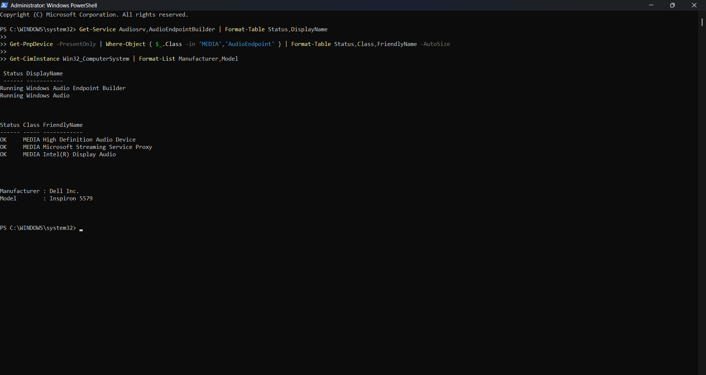
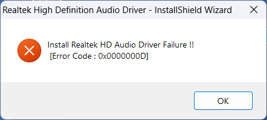

# Case Study 13 — Windows Audio Recovery on a Dell Inspiron 5579

**Date:** October 15, 2026

**Status:** Resolved — sound restoration confirmed by the device owner after installing the Realtek audio driver through Windows Update.

## Objective

Restore sound on a previously refurbished laptop, document the troubleshooting evidence, and prepare a record suitable for a public technical portfolio.

This is a follow-up to the [original Dell inspection and refurbishment case](../01-bench-setup/README.md).

## Environment

| Component | Recorded information |
|---|---|
| Device | Dell Inspiron 5579 |
| Operating system | Windows 11; exact build not captured |
| Audio controller | Realtek ALC3253-VA3, according to Dell's model specifications |
| Initial PnP audio-device label | High Definition Audio Device |
| Additional detected audio device | Intel(R) Display Audio |
| Selected Windows Update package | Realtek Semiconductor Corp. — MEDIA — 6.0.1.8184; displayed driver date June 13, 2017 |

## Initial Symptoms

- No audible sound.
- The taskbar volume indicator and Quick Settings slider appeared inconsistent.
- The mute control did not respond as expected.
- The volume slider later became unavailable.
- Sound settings reported both **No output devices found** and **No input devices found**.

The symptoms persisted after service restarts and a user-reported system restart. The taskbar icon alone did not establish whether the system was muted or whether an audio endpoint was available.

## Diagnostic Process

1. Checked Sound settings for available playback and recording devices. Both lists were empty.
2. Restarted Windows Audio and Windows Audio Endpoint Builder. This did not restore sound.
3. Used PowerShell to check service status, currently detected audio devices, and the computer model.
4. Confirmed that both audio services were **Running**. The High Definition Audio Device and Intel(R) Display Audio entries reported **OK**, but no `AudioEndpoint` entries appeared in the filtered result.
5. Attempted to install Dell's model-compatible Realtek driver package, DXXVT, version 6.0.1.8184. The installer failed with `0x0000000D`.
6. Inspected the recent Windows device-installation log. It recorded a file-copy failure involving `RtkDataProc64.dll`, **Error 13: The data is invalid**, and a failed driver-package import.
7. Checked Windows Update's optional driver updates for an audio package matching the laptop.

### Read-Only Diagnostic Commands

```powershell
Get-Service Audiosrv,AudioEndpointBuilder | Format-Table Status,DisplayName

Get-PnpDevice -PresentOnly |
    Where-Object { $_.Class -in 'MEDIA','AudioEndpoint' } |
    Format-Table Status,Class,FriendlyName -AutoSize

Get-CimInstance Win32_ComputerSystem | Format-List Manufacturer,Model

Get-Content "$env:windir\INF\setupapi.dev.log" -Tail 400 |
    Select-String -Pattern '!!!|Exit status|Section start' -Context 2,2
```

Raw installation logs can contain account paths and device-instance identifiers. Review and sanitize their output before publishing.

## Evidence

### Services and Detected Hardware



*Original screenshot reviewed for publication. Both audio services were running and the media devices reported OK; no AudioEndpoint entries appeared in this result.*

### Failed Manual Installation



*The Dell Realtek installer failed. The error dialog contains no account information or device identifiers.*

### Sanitized Installation-Log Excerpt

```text
Device Install: UpdateDriverForPlugAndPlayDevices
Device instance: [DEVICE_INSTANCE_REDACTED]
INF path: C:\Program Files (x86)\Realtek\Audio\Drivers\Win64\HDXMA7.inf
File operation: copy RtkDataProc64.dll to %TEMP%\[TEMP_FOLDER_REDACTED]
FileQueueCommit aborting
Error 13: The data is invalid.
Driver package import failed for device.
Exit status: FAILURE(0x0000000d)
```

This is an abbreviated transcription of the captured log, with personal paths and identifiers replaced. It is not a complete original log. See [sanitized diagnostic excerpts](evidence/diagnostics-sanitized.txt) for the service and device results as well.

The Sound settings and Windows Update screenshots contained account information and are represented here by reviewed text summaries. No post-fix screenshot was captured for this record.

## Repair / Remediation

1. Opened **Settings → Windows Update → Check for updates**.
2. Navigated to **Advanced options → Optional updates → Driver updates**.
3. Identified **Realtek Semiconductor Corp. — MEDIA — 6.0.1.8184** as the audio package. The instructions targeted this entry; unrelated firmware, network, image, and system packages were not part of the requested audio repair.
4. Installed the selected audio driver through Windows Update. The device owner subsequently confirmed that this worked and sound returned.

A Windows restart was included in the repair instructions. Completion of that particular restart was not separately captured, so persistence after a further deliberate restart remains an additional validation item.

## Findings

**Evidence-supported conclusion:** Audio became available after the Realtek driver was installed through Windows Update. This supports an audio-driver or device-configuration problem as the likely explanation for the missing endpoints.

**Limits of the diagnosis:** The precise trigger for the original failure was not established. The manual installer's file-copy/import error was documented, but its underlying cause was not proven. The record does not establish file corruption, a permissions problem, a Windows update regression, or physical hardware failure.

The successful Windows Update entry displayed the same driver version as the failed Dell package. This case demonstrates that the delivery or installation path can affect the outcome; it does not prove that a newer driver version fixed the issue.

## Validation

- [x] Captured the initial absence of playback and recording devices.
- [x] Verified both Windows audio services were running.
- [x] Recorded detected media-device status.
- [x] Recorded the manual installer error and relevant log evidence.
- [x] Identified the Realtek MEDIA package in Windows Update.
- [x] Device owner confirmed sound returned after this installation path.
- [ ] Capture the post-fix output-device name and installed driver version.
- [ ] Verify sound persists after a further deliberate restart.
- [ ] Test the microphone and wired-headphone output separately.

Unchecked items are additional validation opportunities, not completed tests. Sound restoration is the confirmed outcome.

## Privacy Review

- Included only the two screenshots that contain no visible personal account details, network names, recovery keys, serial numbers, or unique device-instance identifiers.
- Replaced the username-containing temporary path and full device instance in the installation-log excerpt with explicit placeholders.
- Omitted the raw account-bearing settings screenshots and the unsanitized installation-log screenshot.
- Retained the public hardware model, driver version, generic Windows paths, diagnostic commands, and error code because they are relevant to reproducing the troubleshooting method.
- Removed PNG text/EXIF metadata if present, preserving the screenshot pixel data. No generative image editing was used.

The privacy review applies to the evidence included in this follow-up case study.

## Lessons Learned

- Check the available playback and recording devices instead of interpreting an icon as a diagnosis.
- Distinguish a running audio service, a detected controller, and an available audio endpoint. A PnP status of OK did not mean that speakers or a microphone were available to applications.
- Preserve the exact error and inspect the device-installation log when a driver installer fails.
- Windows Update can provide a useful installation path for a model-matched audio driver when a vendor installer fails.
- Separate observed results from hypotheses and mark tests that were not recorded.
- Sanitize screenshots and logs before adding troubleshooting evidence to a public repository.

## Skills Demonstrated

Windows endpoint troubleshooting, PowerShell diagnostics, driver installation, log analysis, controlled remediation, privacy review, and technical documentation.

## References

- [Dell Inspiron 5579 audio specifications](https://www.dell.com/support/manuals/en-re/inspiron-15-5579-2-in-1-laptop/inspiron-15-5579-setup-specifications/Audio?guid=guid-f0c62210-7213-464a-bc85-165b488eeb8b&lang=en-us)
- [Dell Realtek driver package DXXVT](https://www.dell.com/support/home/en-us/drivers/driversdetails?driverid=dxxvt)
- [Microsoft: missing or undetected audio output devices](https://support.microsoft.com/en-us/windows/hardware/audio/fix-missing-or-undetected-audio-output-device-in-windows)
- [Microsoft: installing recommended and optional drivers](https://support.microsoft.com/en-au/windows/hardware/drivers/automatically-get-recommended-and-updated-hardware-drivers)
- [Microsoft: SetupAPI device-installation log](https://learn.microsoft.com/en-us/windows-hardware/drivers/install/setupapi-device-installation-log-entries)
